# 🏪 CafeSmart ML: Business Intelligence & Feature Engineering Guide

> **🎓 Online Course Module: Understanding Business-Driven ML**

---

## 🎯 **Learning Objectives**

By the end of this module, you will be able to:

| ✅ **Knowledge** | 🎯 **Skills** | 💡 **Insights** |
|------------------|---------------|-----------------|
| • How cafe operations create data patterns | • Identify business-driven features | • Data reflects business reality |
| • Why specific features improve predictions | • Map business questions to data needs | • Domain knowledge drives ML success |
| • How business logic translates to ML features | • Design feature engineering pipelines | • Understanding the "why" is crucial |

---

## 🎨 **Visual Learning Elements**

This course uses **interactive diagrams** to enhance your learning experience:

### 📊 **Diagram Types**
| Type | Purpose | How to View |
|------|---------|-------------|
| 🎯 **Text Diagrams** | Always visible | ✅ Any Markdown viewer |
| 🎨 **Mermaid Diagrams** | Interactive visuals | 🔗 [Mermaid Live Editor](https://mermaid.live/) |

### 🚀 **Quick Start: View Interactive Diagrams**
1. **Copy** the Mermaid code (between ```mermaid tags)
2. **Paste** into [Mermaid Live Editor](https://mermaid.live/)
3. **Explore** the interactive diagram
4. **Experiment** with different layouts and colors

---

## 🏪 **Module 1: Understanding the Cafe Business Model**

### 🎬 **Business Operations Flow**

**📊 Visual Diagram:**

**📊 Business Operations Flow Diagram:**

**📋 Text Version (Always Visible):**
```
🛒 Customer Orders → 🍽️ Menu Items → 📋 Recipe Components → 📦 Inventory Items → 🚚 Supplier Orders

⏰ Daily Operations:
├── 🌅 Peak Hours: 7-9am, 12-2pm
├── 📅 Weekend vs Weekday Patterns  
└── 🌤️ Seasonal Trends

🎯 Business Goals:
├── ♻️ Minimize Waste
├── 🌟 Maximize Freshness
├── 💰 Optimize Inventory Costs
└── 😊 Ensure Customer Satisfaction
```

**🎨 Interactive Version (Copy to Mermaid Live Editor):**
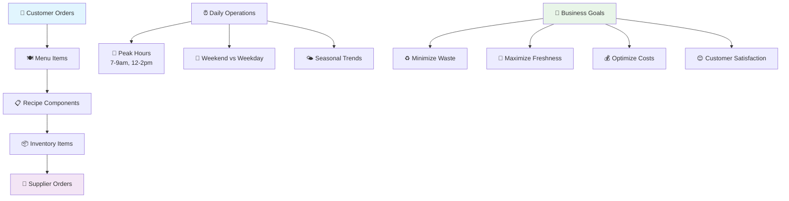

---

## 🏪 Understanding the Cafe Business Model

### Core Business Operations

**Text-Based Diagram:**
```
Customer Orders → Menu Items → Recipe Components → Inventory Items → Supplier Orders
     ↓
Daily Operations:
├── Peak Hours: 7-9am, 12-2pm
├── Weekend vs Weekday Patterns  
└── Seasonal Trends
     ↓
Business Goals:
├── Minimize Waste
├── Maximize Freshness
├── Optimize Inventory Costs
└── Ensure Customer Satisfaction
```

**Mermaid Diagram (for supported viewers):**
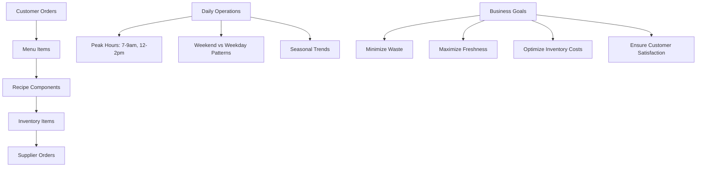

### 🚨 **Key Business Challenges**

| 🎯 **Challenge** | 💥 **Impact** | 📊 **Data Needed** |
|------------------|---------------|-------------------|
| **♻️ Inventory Waste** | 15-20% of ingredients discarded | Usage patterns, shelf life |
| **❌ Stockouts** | Lost sales, customer dissatisfaction | Demand forecasting, lead times |
| **📦 Over-ordering** | Increased costs, storage issues | Accurate demand prediction |
| **⏰ Peak Demand** | Service delays, quality issues | Temporal patterns, capacity planning |

---

## 📈 **Module 2: Data Collection Strategy**

### 🎯 **Why We Collect What We Collect**

**📋 Text Version (Always Visible):**
```
🤔 Business Question → 📊 Data Need → 🔧 Feature Engineering → 🤖 ML Prediction

🔍 Specific Mappings:
"When will we run out?" → 📈 Historical usage patterns → usage_lag_1d, usage_lag_7d
"What affects demand?" → ⏰ Temporal patterns → day, weekday, month, year  
"How much to order?" → 📦 Order volume patterns → orders_total_lag_1d, items_total_lag_1d
"What's the trend?" → 📊 Rolling averages → rolling_usage_last_7d
"Seasonal patterns?" → 🌤️ Long-term patterns → usage_same_weekday_lag_28d
```

**🎨 Interactive Version (Copy to Mermaid Live Editor):**
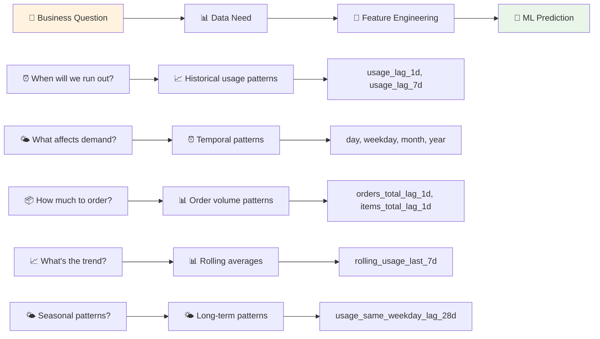

---

## 📈 Data Collection Strategy

### Why We Collect What We Collect

**Text-Based Diagram:**
```
Business Question → Data Need → Feature Engineering → ML Prediction

Specific Mappings:
"When will we run out?" → Historical usage patterns → usage_lag_1d, usage_lag_7d
"What affects demand?" → Temporal patterns → day, weekday, month, year  
"How much to order?" → Order volume patterns → orders_total_lag_1d, items_total_lag_1d
"What's the trend?" → Rolling averages → rolling_usage_last_7d
"Seasonal patterns?" → Long-term patterns → usage_same_weekday_lag_28d
```

**Mermaid Diagram (for supported viewers):**
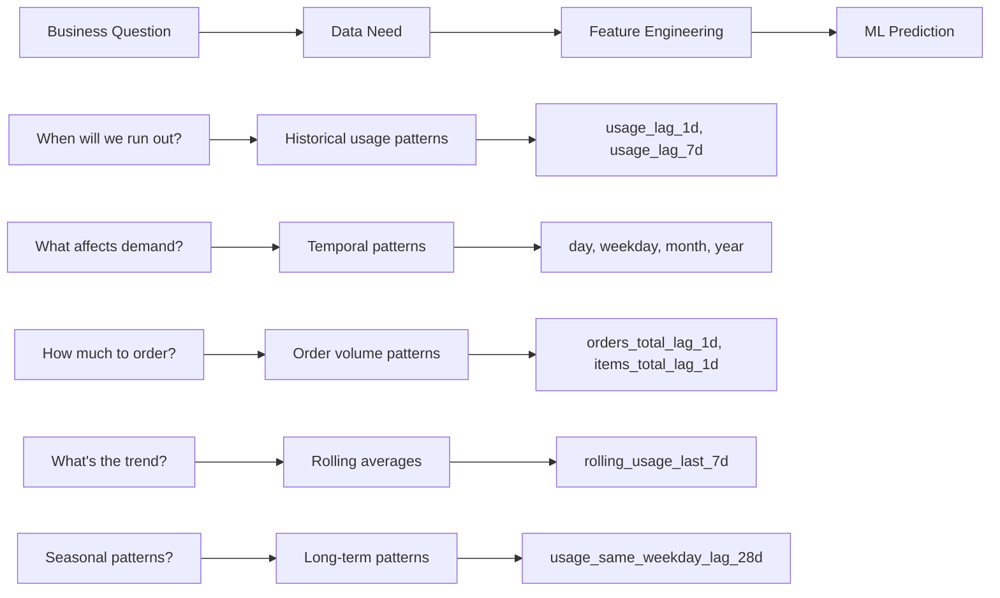

---

## 🍳 **Module 3: Recipe-to-Ingredient Mapping**

### 🎬 **Understanding the Data Transformation**

**📋 Text Version (Always Visible):**
```
🛒 Customer Order → 🍽️ Menu Item Selection → 📋 Recipe Lookup → 📦 Ingredient Requirements → 📊 Inventory Consumption

📋 Example Flow:
Order: 2 Lattes + 1 Croissant
├── 🍽️ Menu Items: COFFEE-001, COFFEE-001, CROISSANT-001
├── 📋 Recipes: Latte Recipe, Croissant Recipe
├── 📦 Ingredients: 18g beans × 2, 200ml milk × 2, 1 croissant dough
└── 📊 Final Usage: BEANS-ESP-1KG: 36g, DAIRY-MILK-1L: 400ml, BAKERY-DOUGH-CROIS: 1 unit

♻️ Wastage Calculation:
5% milk spillage → 400ml + 20ml = 420ml
Additional 10% buffer → 462ml total
```

**🎨 Interactive Version (Copy to Mermaid Live Editor):**
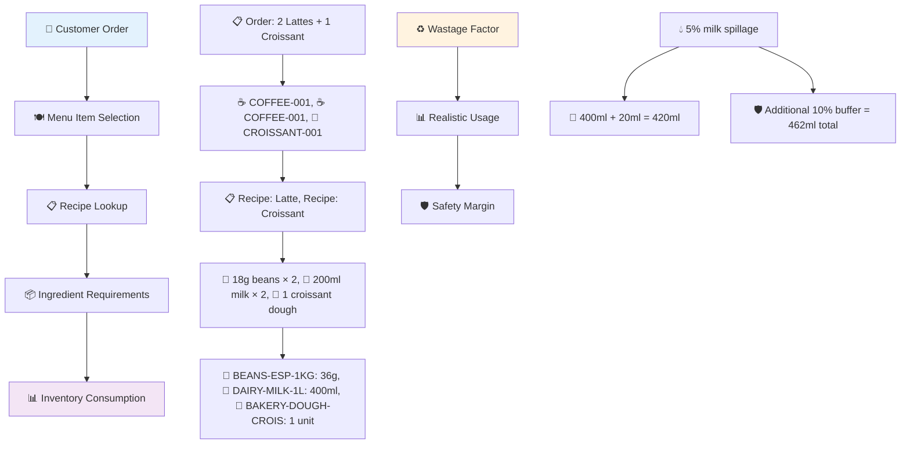

### 📋 **Recipe Component Structure**

```json
{
  "menuItemId": "COFFEE-001",
  "name": "☕ Latte",
  "components": [
    {
      "sku": "🫘 BEANS-ESP-1KG",
      "unitsPerItem": 0.018,
      "wastageRate": 0.02
    },
    {
      "sku": "🥛 DAIRY-MILK-1L", 
      "unitsPerItem": 0.2,
      "wastageRate": 0.05
    }
  ]
}
```

---

## 📊 **Module 4: Feature Engineering Breakdown**

### ⏰ **Temporal Features**

**📋 Text Version (Always Visible):**
```
⏰ Temporal Features:
├── 📅 Day of Month → 💰 Payday patterns (1st, 15th, 30th)
├── 📆 Weekday → 😴 Monday blues, 🎉 Friday rush
├── 🌤️ Month → 🌤️ Seasonal trends (Summer vs Winter)
├── 📈 Year → 📈 Year-over-year growth
└── 🎉 Is Weekend → 🎉 Weekend vs weekday (different customer base)
```

**🎨 Interactive Version (Copy to Mermaid Live Editor):**
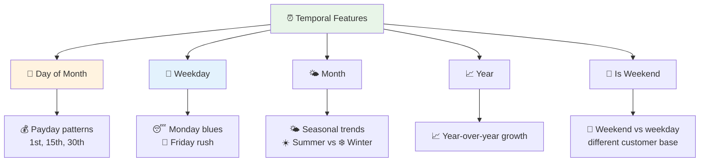

---

## 📊 Feature Engineering Breakdown

### Temporal Features

**Text-Based Diagram:**
```
Temporal Features:
├── Day of Month → Payday patterns (1st, 15th, 30th)
├── Weekday → Monday blues, Friday rush
├── Month → Seasonal trends (Summer vs Winter)
├── Year → Year-over-year growth
└── Is Weekend → Weekend vs weekday (different customer base)
```

**Mermaid Diagram (for supported viewers):**
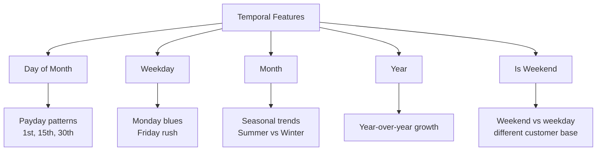

**💡 Business Logic:**
- **📅 Day of Month**: 💰 Payday effects, 📊 monthly budget cycles
- **📆 Weekday**: 🚇 Commuter patterns, 🏢 office vs 🏠 residential areas
- **🌤️ Month**: 🌤️ Seasonal beverages, 🌦️ weather impact
- **📈 Year**: 📈 Business growth, 🚀 market expansion
- **🎉 Is Weekend**: 👥 Different customer demographics, ⏰ longer dwell times

### 📈 **Lag Features**

**📋 Text Version (Always Visible):**
```
📊 Today's Prediction:
├── 📅 Yesterday's Usage → ⚡ Immediate trends, 🆕 Recent events
├── 📆 Last Week's Usage → 📊 Weekly patterns, 🔄 Business cycles
└── 📅 Last Month's Usage → 🌤️ Seasonal patterns, 📈 Long-term trends

📊 Rolling Averages:
7-day moving average → 📈 Smooths daily variations
```

**🎨 Interactive Version (Copy to Mermaid Live Editor):**
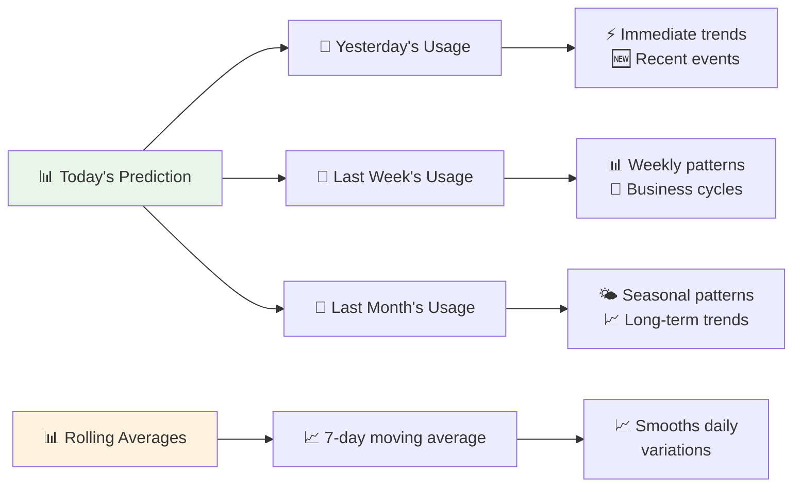

**💡 Why These Lags Matter:**

| 📊 **Feature** | 🎯 **Business Reason** | 💥 **Example Impact** |
|----------------|----------------------|----------------------|
| `usage_lag_1d` | ⚡ Immediate demand continuity | 🌦️ Yesterday's weather affects today |
| `usage_lag_7d` | 🔄 Weekly business cycles | 📅 Same day last week patterns |
| `usage_lag_28d` | 📊 Monthly patterns | 💰 Payday cycles, 📈 monthly budgets |
| `rolling_usage_last_7d` | 📈 Trend smoothing | 📉 Reduces noise from daily variations |

### 📦 **Volume Features**

**📋 Text Version (Always Visible):**
```
📦 Order Volume Features:
├── 📊 orders_total_lag_1d → 👥 Number of transactions, 👤 Customer count
└── 📦 items_total_lag_1d → 📊 Total items sold, 📈 Average order size

💡 Business Insights:
├── 👥 Customer behavior
├── ⚙️ Operational efficiency
└── 👨‍💼 Staffing needs
```

**🎨 Interactive Version (Copy to Mermaid Live Editor):**
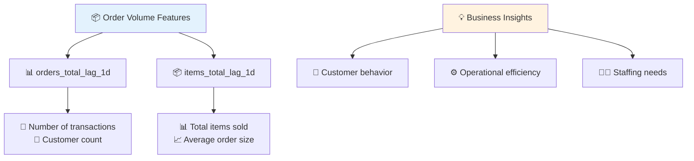

**💡 Business Logic:**
- **📊 orders_total_lag_1d**: 👥 Customer traffic patterns, 📢 marketing effectiveness
- **📦 items_total_lag_1d**: 📈 Average order size, 🍽️ menu popularity

---

## 🎯 **Module 5: Target Variable - `target_usage`**

### 🤔 **Why We Predict Usage, Not Sales**

**📋 Text Version (Always Visible):**
```
🎯 Business Goal → 📦 Inventory Management:
├── ❌ Prevent Stockouts
└── ♻️ Minimize Waste

📊 Prediction Target → 📈 Usage Prediction:
├── 📦 Ingredient Consumption
└── 📋 Inventory Planning

🤔 Why Not Sales? → 📊 Sales ≠ Usage:
├── 📋 Recipe variations
├── ♻️ Wastage factors
└── 👨‍💼 Staff training differences
```

**🎨 Interactive Version (Copy to Mermaid Live Editor):**
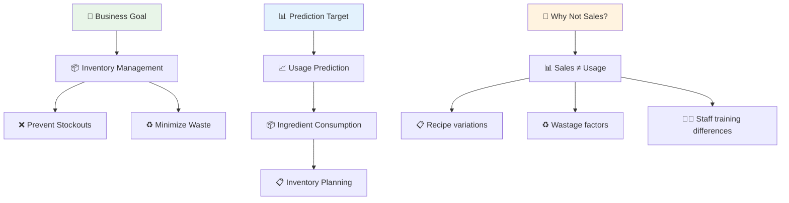

**Key Insight**: We predict **ingredient usage**, not **menu item sales**, because:
- Different staff members use different amounts of ingredients
- Wastage rates vary by day, staff, and conditions
- Recipe adherence varies
- Actual consumption drives inventory decisions

---

## 📋 CSV Structure Explanation

### Complete Feature Set

```csv
sku,date,year,month,day,weekday,is_weekend,orders_total_lag_1d,items_total_lag_1d,usage_lag_1d,usage_lag_7d,rolling_usage_last_7d,usage_same_weekday_lag_28d,target_usage
BEANS-ESP-1KG,2025-09-01,2025,9,1,2,false,45,127,8.5,7.2,7.8,6.9,8.2
```

### Feature Categories

| Category | Features | Business Purpose |
|----------|----------|------------------|
| **Identification** | `sku`, `date` | Data organization, filtering |
| **Temporal** | `year`, `month`, `day`, `weekday`, `is_weekend` | Seasonal patterns, business cycles |
| **Volume** | `orders_total_lag_1d`, `items_total_lag_1d` | Customer traffic, order patterns |
| **Usage History** | `usage_lag_1d`, `usage_lag_7d`, `usage_same_weekday_lag_28d` | Demand patterns, trends |
| **Trends** | `rolling_usage_last_7d` | Smoothed demand patterns |
| **Target** | `target_usage` | What we're trying to predict |

---

## 🔍 Business Intelligence Insights

### Pattern Recognition

**Text-Based Diagram:**
```
Data Patterns:
├── Daily Patterns:
│   ├── Morning rush (7-9am peak)
│   ├── Lunch rush (12-2pm peak)
│   └── Afternoon lull (2-5pm quiet)
├── Weekly Patterns:
│   ├── Monday: Low (Post-weekend)
│   ├── Friday: High (Weekend prep)
│   └── Weekend: Different (Leisure customers)
├── Monthly Patterns:
│   ├── Payday effects (1st & 15th)
│   └── Month-end (Budget constraints)
└── Seasonal Patterns:
    ├── Summer: Iced drinks
    ├── Winter: Hot drinks
    └── Holiday seasons (Special events)
```

**Mermaid Diagram (for supported viewers):**
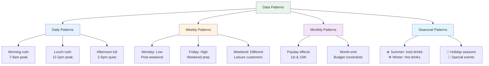

---

## 🎯 **Module 6: Pattern Recognition**

### 📊 **Data Patterns**

**📋 Text Version (Always Visible):**
```
📊 Data Patterns:
├── 🌅 Daily Patterns:
│   ├── 🌅 Morning rush (7-9am peak)
│   ├── 🍽️ Lunch rush (12-2pm peak)
│   └── 😴 Afternoon lull (2-5pm quiet)
├── 📅 Weekly Patterns:
│   ├── 😴 Monday: Low (Post-weekend)
│   ├── 🎉 Friday: High (Weekend prep)
│   └── 🎉 Weekend: Different (Leisure customers)
├── 📊 Monthly Patterns:
│   ├── 💰 Payday effects (1st & 15th)
│   └── 📊 Month-end (Budget constraints)
└── 🌤️ Seasonal Patterns:
    ├── ☀️ Summer: Iced drinks
    ├── ❄️ Winter: Hot drinks
    └── 🎉 Holiday seasons (Special events)
```

**🎨 Interactive Version (Copy to Mermaid Live Editor):**
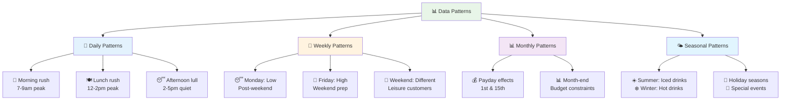

---

## 🎯 **Module 7: Decision-Making Process**

### 📊 **Business Decision Flow**

**📋 Text Version (Always Visible):**
```
📊 Historical Data → 🔧 Feature Engineering → 🤖 ML Model Training → 📈 Prediction Generation → 🎯 Business Decision

🎯 Business Decision Components:
├── 📋 Reorder Point Calculation → ROP = Safety Stock + Lead Time Demand
├── 📦 Order Quantity → Order Qty = Par Level - Current Stock
└── 🛡️ Safety Stock → Safety Stock = Max(Reorder Threshold, Historical Variance)
```

**🎨 Interactive Version (Copy to Mermaid Live Editor):**
```mermaid
graph LR
    A[📊 Historical Data] --> B[🔧 Feature Engineering]
    B --> C[🤖 ML Model Training]
    C --> D[📈 Prediction Generation]
    D --> E[🎯 Business Decision]
    
    E --> F[📋 Reorder Point Calculation]
    E --> G[📦 Order Quantity]
    E --> H[🛡️ Safety Stock]
    
    F --> I[📋 ROP = Safety Stock + Lead Time Demand]
    G --> J[📦 Order Qty = Par Level - Current Stock]
    H --> K[🛡️ Safety Stock = Max(Reorder Threshold, Historical Variance)]
    
    style A fill:#e8f5e8
    style C fill:#e3f2fd
    style E fill:#fff3e0
```

### 🔍 **Key Differences: Sales vs Usage**

| 📊 **Aspect** | 🍽️ **Sales Data** | 📦 **Usage Data** |
|---------------|-------------------|------------------|
| **📋 What it measures** | Menu item orders | Actual ingredient consumption |
| **🎯 Accuracy** | Precise order counts | Includes wastage, spillage |
| **💰 Business value** | Revenue tracking | Inventory planning |
| **🤖 ML relevance** | Menu optimization | Stock management |

---

## 🎓 **Module 8: Learning Outcomes & Key Takeaways**

### 🎯 **What Students Should Understand**

| 📚 **Learning Area** | 🎯 **Key Understanding** | 💡 **Business Impact** |
|---------------------|-------------------------|----------------------|
| **🏪 Business Context** | How cafe operations create data patterns | Better feature selection |
| **🔧 Feature Selection** | Why specific features improve prediction accuracy | More accurate models |
| **📊 Data Quality** | How business processes affect data reliability | Trustworthy predictions |
| **🤖 Model Interpretability** | How features relate to business decisions | Actionable insights |
| **🔄 Continuous Improvement** | How feedback loops improve predictions | Ongoing optimization |

### 💡 **Key Takeaways**

| 🎯 **Insight** | 💡 **Why It Matters** | 🚀 **Application** |
|----------------|----------------------|-------------------|
| **📊 Data reflects business reality** | Every feature has a business justification | Better feature engineering |
| **⏰ Temporal patterns matter** | Time-based features capture business cycles | Improved predictions |
| **📦 Volume ≠ Usage** | Understanding the difference is crucial for inventory management | Accurate stock planning |
| **🔧 Feature engineering is domain-specific** | Different businesses need different features | Customized solutions |
| **💼 Business logic drives ML success** | Understanding the domain improves model performance | Higher ROI |

---

## 📚 **Module 9: Further Reading & Resources**

### 🎓 **Recommended Learning Path**

| 📖 **Topic** | 🎯 **Focus Area** | 📚 **Resources** |
|-------------|------------------|------------------|
| **📦 Inventory Management** | EOQ models, safety stock calculations | Operations Research textbooks |
| **📊 Time Series Analysis** | ARIMA, seasonal decomposition | Statistical modeling courses |
| **🔧 Feature Engineering** | Domain-specific feature creation | ML engineering best practices |
| **💡 Business Intelligence** | Converting data into actionable insights | Business analytics courses |

### 🚀 **Interactive Learning Activities**

| 🎯 **Activity** | 📋 **Description** | 💡 **Learning Outcome** |
|-----------------|-------------------|------------------------|
| **🔍 Feature Analysis** | Analyze which features most impact predictions | Understanding feature importance |
| **📊 Pattern Recognition** | Identify business patterns in data | Developing business intuition |
| **🤖 Model Interpretation** | Explain predictions in business terms | Building interpretable ML systems |
| **📈 Performance Tracking** | Monitor prediction accuracy over time | Continuous improvement mindset |

---

## 🔗 **Related Documentation**

| 📄 **Document** | 🎯 **Purpose** | 🔗 **Link** |
|-----------------|-----------------|-------------|
| **📡 API Reference** | Complete API documentation | [Predictions.md](./Predictions.md) |
| **🔧 Implementation** | Technical implementation details | [CafeSmartMLTutorial.docc](../CafeSmartMLTutorial.docc/) |
| **📚 Tutorials** | Step-by-step learning guides | [Tutorials](../CafeSmartMLTutorial.docc/Tutorials/) |

---

## 📝 **Version History**

| 📊 **Version** | 📅 **Date** | 🔄 **Changes** |
|----------------|-------------|----------------|
| 1.0 | 2025-09-01 | Initial documentation |
| 1.1 | 2025-09-01 | Added business intelligence insights |
| 1.2 | 2025-09-01 | Enhanced feature engineering explanations |
| 1.3 | 2025-09-01 | **🎨 Enhanced for online learning with visual elements** |

---

## 🎯 **Course Completion Checklist**

| ✅ **Module** | 🎯 **Learning Objective** | 📊 **Assessment** |
|---------------|---------------------------|------------------|
| **🏪 Business Model** | Understand cafe operations | Can explain business flow |
| **📈 Data Strategy** | Know why we collect specific data | Can justify feature choices |
| **🍳 Recipe Mapping** | Understand data transformation | Can trace order to usage |
| **📊 Feature Engineering** | Know feature types and purposes | Can categorize features |
| **🎯 Target Variables** | Understand usage vs sales | Can explain prediction targets |
| **📊 Pattern Recognition** | Identify business patterns | Can spot temporal trends |
| **🎯 Decision Making** | Understand ML-driven decisions | Can explain business logic |
| **💡 Key Takeaways** | Apply learning to new scenarios | Can transfer knowledge |

---

*🎓 **This document provides the foundation for understanding how business operations drive data collection and feature engineering decisions in ML systems. Perfect for online learning with interactive visual elements!*** 🚀
